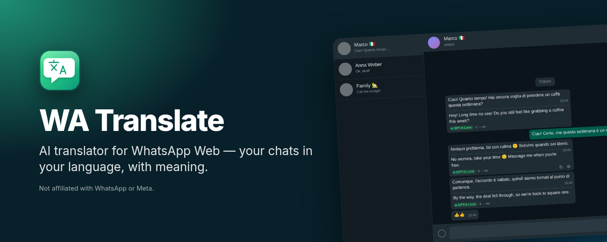
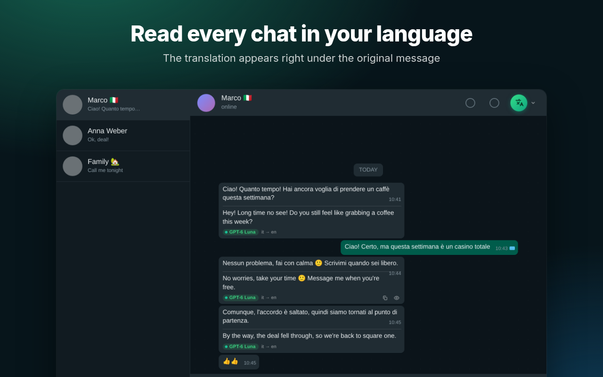
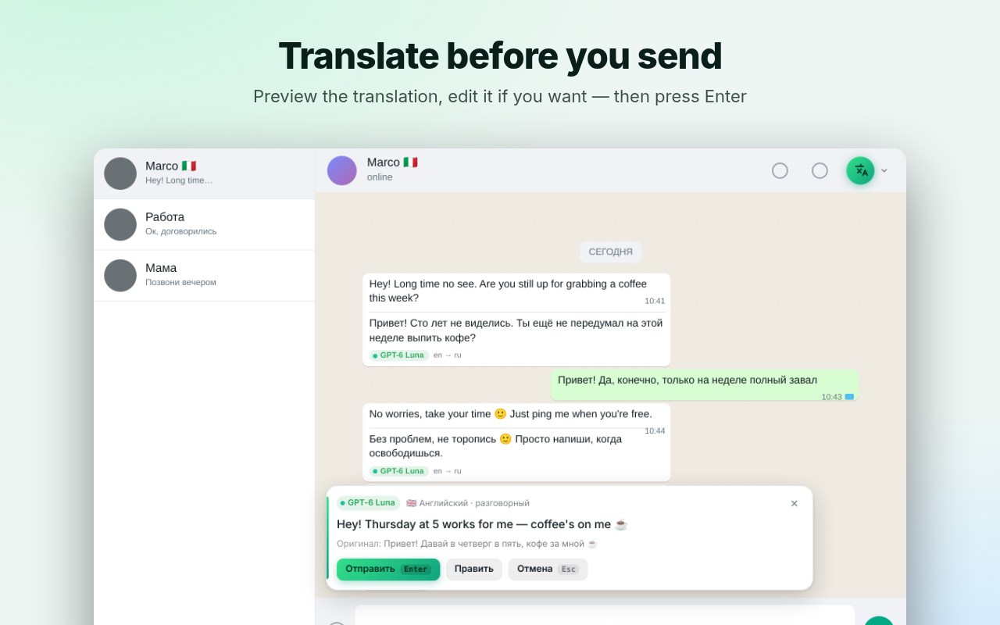
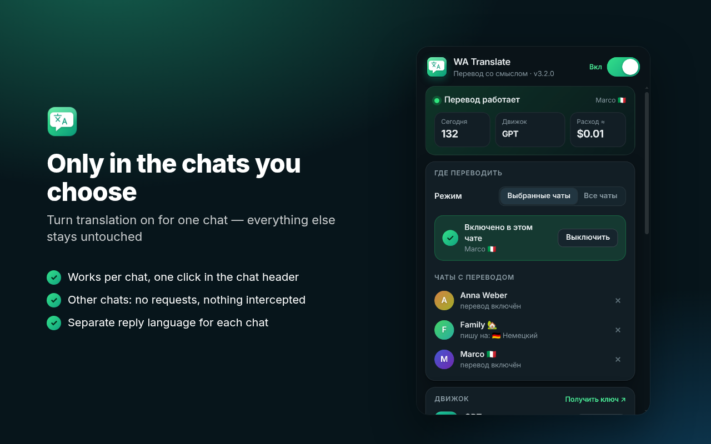
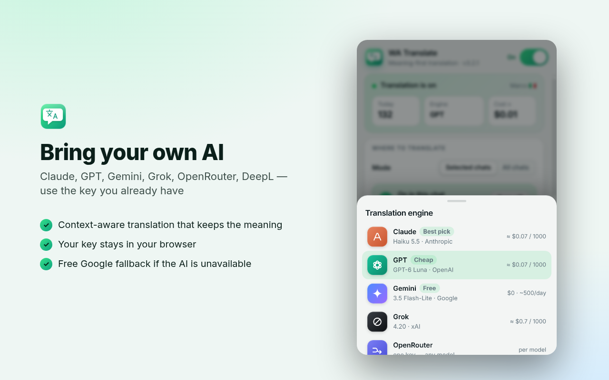

  

<h1 align="center">WA Translate</h1>

<b>AI translator for WhatsApp Web</b> — read every chat in your language and reply in theirs, with <i>meaning</i>, not word by word.

   
  
  
  
  

  <a href="https://fls-dev.github.io/wa_translate_store/"><b>Website</b></a> ·
  <a href="https://fls-dev.github.io/wa_translate_store/privacy.html"><b>Privacy policy</b></a> ·
  <a href="https://github.com/fls-dev/wa_translate_store/raw/main/extension/wa-translate-3.2.1.zip"><b>Download ZIP</b></a> ·
  <a href="https://github.com/fls-dev/wa_translate_store/issues"><b>Support</b></a>

---

## What it does

WA Translate is an independent Chrome extension for **web.whatsapp.com**. Incoming messages are translated right under the original text; your own replies are translated **before they are sent**. It uses the AI you already have (Claude, GPT, Gemini, Grok, OpenRouter) or DeepL — and it only works in the chats **you** choose.

<table>
  <tr>
    <td width="50%"></td>
    <td width="50%"></td>
  </tr>
  <tr>
    <td align="center"><b>Read</b> — translation appears under the original</td>
    <td align="center"><b>Reply</b> — check the translation, then press Enter</td>
  </tr>
  <tr>
    <td width="50%"></td>
    <td width="50%"></td>
  </tr>
  <tr>
    <td align="center"><b>Per chat</b> — off by default, one click to enable</td>
    <td align="center"><b>Your engine</b> — switch any time</td>
  </tr>
</table>

## Features

- **Translation that keeps the meaning.** AI engines get the recent conversation as context, so slang, tone, idioms, names and short replies ("ok", "same") are handled like a human would.
- **Incoming, in place.** The translation sits under each message with a small badge showing the engine and languages. The original stays visible; copy or hide the translation with one click.
- **Replies with a safety net.** Write in your language, press <kbd>Enter</kbd>, review the translation in a preview card, then send, edit or cancel. An optional *instant send* mode skips the preview. If anything goes wrong the extension sends **nothing** — never your untranslated text by mistake.
- **Only the chats you choose.** Off by default. Enable a chat from the button in its header; each chat can have its own reply language. In every other chat the extension does nothing (no requests, <kbd>Enter</kbd> works as usual). Or switch to *all chats* and exclude a few.
- **25 languages**, automatic source-language detection, *casual* or *business* style for your replies.
- **Bring your own key.** Pay your AI provider directly (typically a few cents per thousand messages), or use the free Google Translate engine without a key (literal translation).
- **Resilient.** Optional free Google fallback if your AI engine is unavailable; local usage counter with an approximate cost estimate; a *Diagnostics* mode that produces a report **without any message text** if WhatsApp changes its layout.
- **English and Russian interface** (English by default — switch under *Interface language* in the popup).

## Supported engines

| Engine | Model (default) | Needs | Notes |
|---|---|---|---|
| **Claude** (Anthropic) | Haiku 5.5 | your API key | Best quality for slang and tone |
| **GPT** (OpenAI) | GPT-6 Luna | your API key | Cheap and fast |
| **Gemini** (Google) | 3.5 Flash-Lite | your API key | Free tier available (rate-limited) |
| **Grok** (xAI) | 4.20 | your API key | |
| **OpenRouter** | any model | your API key | One key, many models |
| **DeepL** | — | your API key | Free plan: 500k characters / month |
| **Google Translate** | — | nothing | Free, but literal — meaning and slang are lost |

Keys stay in your browser (`chrome.storage.local`) and are sent only to the provider you selected. Default models can be changed in the popup.

## How it works

1. **Pick an engine** and paste your API key (or choose free Google Translate).
2. **Open WhatsApp Web**, click the translate button in a chat header and choose the languages.
3. **Chat.** Read translations under messages; type in your language, press <kbd>Enter</kbd>, check the preview, send.

Under the hood: a content script on `web.whatsapp.com` reads the open chat's text (only in chats you enabled), a background service worker calls the translation provider, and the result is rendered next to the message. Nothing runs anywhere else.

## Install

**Chrome Web Store:** coming soon.

**Manual install (works today)** — Chrome, Edge, Brave, Opera and other Chromium browsers:

1. Download [`wa-translate-3.2.1.zip`](https://github.com/fls-dev/wa_translate_store/raw/main/extension/wa-translate-3.2.1.zip) and unzip it.
2. Open `chrome://extensions` and turn on **Developer mode**.
3. Click **Load unpacked** and select the unzipped folder.
4. Open [web.whatsapp.com](https://web.whatsapp.com), then click the extension icon to choose an engine.

Permissions: only `storage`, plus access to `web.whatsapp.com`. API servers are **optional permissions**, requested one at a time when you pick an engine. No `<all_urls>`, no remote code.

## Privacy

- No account, no developer server, no analytics, no ads.
- Message text goes **only** to the translation provider **you** selected (using **your** key), and only from chats where you turned translation on. With the Google engine or the optional Google fallback, text goes to Google Translate.
- The local translation cache can be cleared in one click.

Full details: **[Privacy policy](https://fls-dev.github.io/wa_translate_store/privacy.html)**.

## FAQ

<b>Is it free?</b>

The extension is free. AI engines are billed by your provider; Google Translate and the Gemini free tier cost nothing.

<b>Does it work with the WhatsApp desktop or phone app?</b>

No — only WhatsApp Web (web.whatsapp.com) in a Chromium-based browser.

<b>WhatsApp changed something and it stopped working.</b>

Turn on <i>Diagnostics</i> in the popup, copy the report (it contains no message text) and <a href="https://github.com/fls-dev/wa_translate_store/issues">open an issue</a>.

<b>Is it official?</b>

No. See the disclaimer below. The extension only reads the page you have open and sends a message after you confirm it.

## Repository layout

| Path | What's inside |
|---|---|
| [`docs/`](docs) | The website (served by GitHub Pages) |
| [`extension/`](extension) | Store-ready ZIP and its SHA-256 |
| [`assets/`](assets) | Icon, screenshots (1280×800), promo tiles |
| [`listing/`](listing) | Chrome Web Store text (EN / RU / PL) |
| [`privacy/`](privacy) | Privacy policy source and Web Store "Privacy practices" answers |
| [`build/build_store.py`](build/build_store.py) | Builds and validates the ZIP |

## Disclaimer

WA Translate is an independent project. It is **not affiliated with, endorsed by, or sponsored by WhatsApp LLC or Meta Platforms, Inc.** "WhatsApp" is a trademark of its respective owner and is used here only to describe compatibility.

## License

[MIT](LICENSE) © 2026 fls-dev
